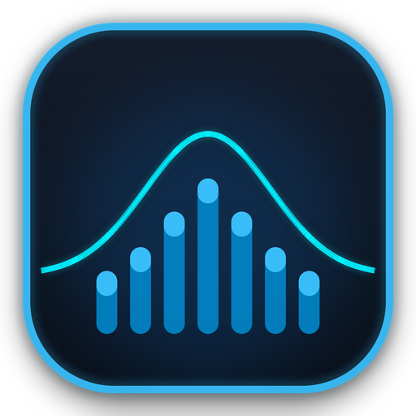
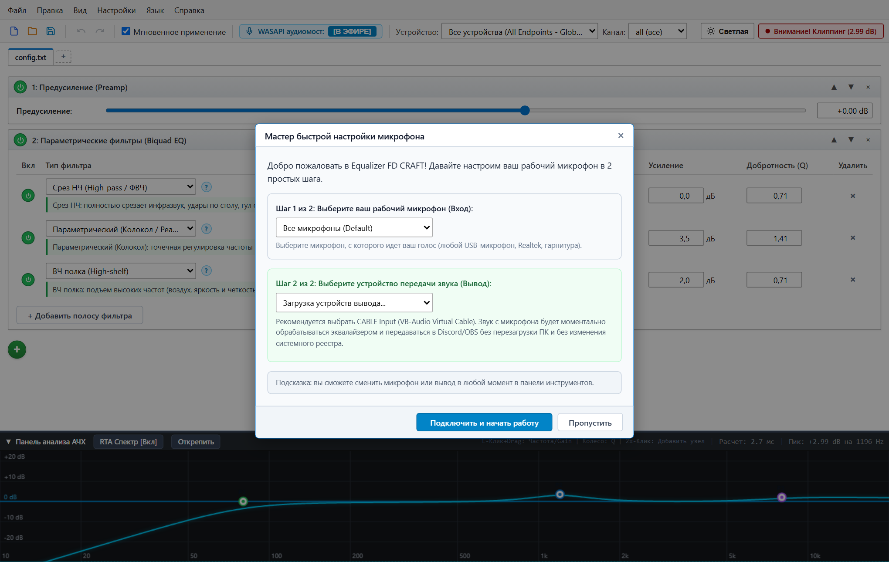
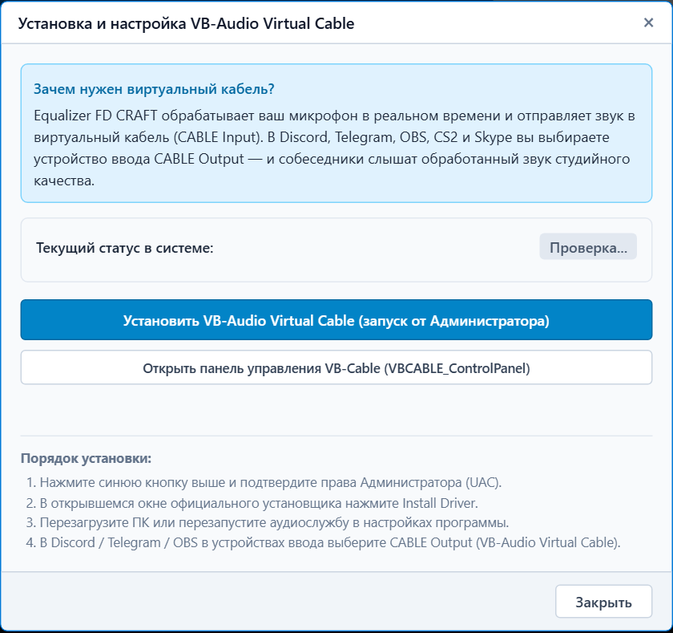
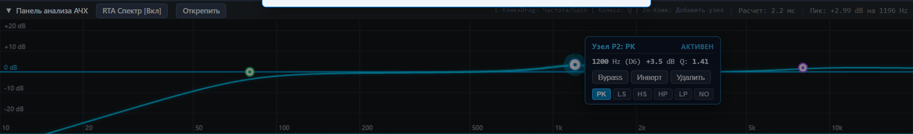
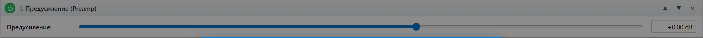
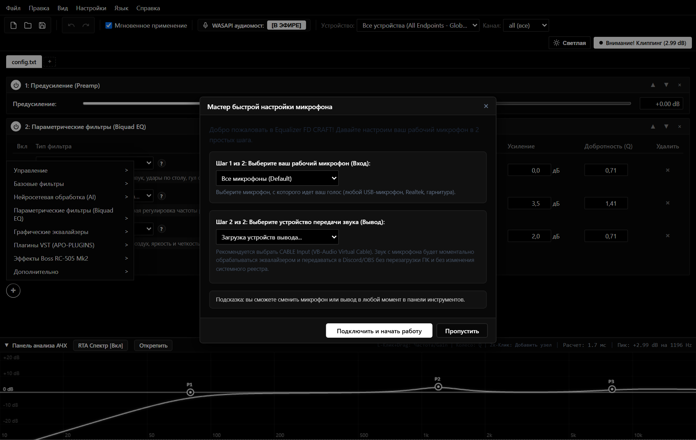

# Equalizer FD CRAFT v1.0.0

<p align="center">
  
</p>

<p align="center">
  <strong>Профессиональная цифровая студия обработки звука микрофона в реальном времени для Windows</strong><br>
  <em>Нейросетевое AI-шумоподавление (RNNoise), интерактивный эквалайзер FabFilter, 98 студийных VST-плагинов и нулевая задержка.</em>
</p>

<p align="center">
  <a href="https://github.com/dimalinau-lab/EqualizerFD-Craft/releases/latest"></a>
  
  
  
  
</p>

<p align="center">
  <strong>Язык документации:</strong>
  <strong>🇷🇺 Русский</strong> |
  <a href="README.en.md">🇬🇧 English</a>
</p>

---

## Оглавление
1. [Простыми словами: что делает эта программа?](#простыми-словами-что-делает-эта-программа)
2. [Экспресс-старт за 3 шага (Для новичков)](#экспресс-старт-за-3-шага-для-новичков)
3. [Как устроен звук: схема маршрутизации](#как-устроен-звук-схема-маршрутизации)
4. [Установка и настройка VB-Audio Virtual Cable](#установка-и-настройка-vb-audio-virtual-cable)
5. [Подробный путеводитель по каждой кнопке](#подробный-путеводитель-по-каждой-кнопке)
   - [1. Верхняя панель управления](#1-верхняя-панель-управления)
   - [2. Интерактивный график эквалайзера (АЧХ)](#2-интерактивный-график-эквалайзера-ачх)
   - [3. Нейросетевое AI-шумоподавление (RNNoise)](#3-нейросетевое-ai-шумоподавление-rnnoise)
   - [4. Предусиление (Preamp) и рэк эффектов](#4-предусиление-preamp-и-рэк-эффектов)
   - [5. Студийные VST-плагины](#5-студийные-vst-плагины)
   - [6. Панель устройств и статус аудиомоста](#6-панель-устройств-и-статус-аудиомоста)
6. [Настройка микрофона в играх и программах (Discord, CS2, Telegram, OBS)](#настройка-микрофона-в-играх-и-программах)
7. [Горячие клавиши (Шпаргалка)](#горячие-клавиши-шпаргалка)
8. [Ответы на частые вопросы (FAQ)](#ответы-на-частые-вопросы-faq)
9. [Сборка из исходников (Для разработчиков)](#сборка-из-исходников-для-разработчиков)

---

## Простыми словами: что делает эта программа?

Представьте, что между вашим обычным микрофоном и вашими собеседниками сидит **профессиональный звукорежиссер**:
- **Удаляет все шумы:** стук клавиш механической клавиатуры, клики мыши, шум вентилятора компьютера или шум с улицы полностью стираются с помощью обученной нейросети (RNNoise).
- **Делает голос сочным и разборчивым:** как на радио, у профессиональных стримеров или в подкастах — убирает неприятный бубнеж, срезает удары по столу, добавляет бархатный бас и кристальную четкость.
- **Работает везде:** в Discord, Telegram, CS2, Dota 2, OBS Studio, Zoom, Skype и любых других играх и программах.



---

## Экспресс-старт за 3 шага (Для новичков)

Если вы хотите получить идеальный микрофон прямо сейчас без долгого чтения — выполните ровно 3 действия:

### Шаг 1. Скачайте и установите программу
Скачайте **`EqualizerFD-Craft-Setup-v1.0.0.exe`** из раздела [Релизов на GitHub](https://github.com/dimalinau-lab/EqualizerFD-Craft/releases/latest) и запустите установку. Установщик автоматически добавит программу и все 98 студийных плагинов.

### Шаг 2. Установите виртуальный кабель (1 клик)
Запустите Equalizer FD CRAFT. В верхнем меню нажмите **«Устройства»** &rarr; **«Установить VB-Audio Virtual Cable»**. В появившемся окне нажмите большую синюю кнопку:



Подтвердите права администратора (UAC) Windows и дождитесь надписи об успешной установке драйвера.

### Шаг 3. Выберите микрофон в Discord или игре
Откройте Discord (или вашу игру), перейдите в **Настройки &rarr; Голос и видео &rarr; Устройство ввода** и выберите:
> **`CABLE Output (VB-Audio Virtual Cable)`**

*Готово! Теперь все ваши друзья и тиммейты слышат чистый, обработанный студийный звук без посторонних шумов.*

---

## Как устроен звук: схема маршрутизации

Чтобы понять, как всё работает «под капотом», посмотрите на простую цепочку:

```
 [Ваш реальный микрофон]
          │
          ▼
 [Equalizer FD CRAFT (В реальном времени)]
   ├─ 1. AI-шумоподавление RNNoise (отсекает стук клавиатуры и клики)
   ├─ 2. Предусиление Preamp (настройка чувствительности)
   ├─ 3. Интерактивный эквалайзер АЧХ (исправление частот голоса)
   └─ 4. Студийные VST-плагины (компрессор, деэссер, теплота)
          │
          ▼
 [CABLE Input (Виртуальный кабель - вход)]
          │
          ▼
 [CABLE Output (Виртуальный кабель - выход)]
          │
          ▼
 [Discord / Игры / CS2 / Telegram / OBS Studio / Стрим]
```

**Что такое виртуальный кабель?**  
Это не физический провод, а специальный виртуальный драйвер Windows. Equalizer FD CRAFT говорит в один конец провода (`CABLE Input`), а Discord слушает из другого конца (`CABLE Output`).

---

## Установка и настройка VB-Audio Virtual Cable

Виртуальный кабель идет в комплекте с программой, вам не нужно искать его в интернете.

1. В верхней строке меню нажмите **«Устройства»** &rarr; **«Установка VB-Audio Virtual Cable»** (или нажмите кнопку со значком кабеля на панели устройств).
2. Нажмите синюю кнопку **«Установить VB-Audio Virtual Cable (запуск от Администратора)»**.
3. В окне контроля учетных записей Windows (UAC) нажмите **«Да»**.
4. В открывшемся установщике нажмите кнопку **«Install Driver»**.
5. Через 5 секунд драйвер установится.
6. *(Рекомендуется один раз перезагрузить компьютер, чтобы Windows окончательно зарегистрировала новое аудиоустройство).*

> [!TIP]
> **Проверка правильности настройки частоты дискретизации:**  
> Чтобы не было задержек и искажений, откройте *Параметры звука Windows &rarr; Панель управления звуком*.  
> Убедитесь, что для вашего реального микрофона и для устройства `CABLE Output` в свойствах (вкладка «Дополнительно») выбран одинаковый студийный формат: **`24 бит, 48000 Гц`** (или `16 бит, 48000 Гц`).

---

## Подробный путеводитель по каждой кнопке

Интерфейс разделен на логические секции. Ниже подробно объяснено назначение каждой кнопки и каждого элемента управления.

---

### 1. Верхняя панель управления

Наверху окна расположена классическая строка меню и быстрые действия:

| Меню / Кнопка | Что делает и зачем нажимать |
| :--- | :--- |
| **Файл &rarr; Создать...** | Создает чистый новый пресет или загружает базовый готовый шаблон. |
| **Файл &rarr; Открыть... (Ctrl+O)** | Открывает сохраненный файл пресета конфигурации (`.txt`). |
| **Файл &rarr; Сохранить (Ctrl+S)** | Сохраняет текущую цепочку эффектов и настройки фильтров в файл. |
| **Файл &rarr; Экспорт...** | Экспортирует настройки для резервной копии или переноса на другой ПК. |
| **Правка &rarr; Отменить (Ctrl+Z)** | Отменяет последнее действие (движение ползунка, изменение точки эквалайзера). |
| **Правка &rarr; Повторить (Ctrl+Y)** | Возвращает отмененное действие. |
| **Пресеты** | Меню с готовыми авторскими пресетами под разные сценарии (Стример, Подкаст, Радио, Гейминг, CS2). |
| **Устройства** | Выбор вашего физического микрофона ввода и аудиомоста. |
| **Темы** | Мгновенное переключение тем: глубокая черная **OLED Dark** или классическая системная **Light** в стиле Windows. |
| **Язык** | Переключение языка интерфейса между русским и английским на лету без перезапуска. |
| **Мастер микрофона** | Пошаговый интерактивный мастер калибровки уровня громкости речи. |
| **Обновления** | Проверка наличия свежих официальных версий на GitHub с возможностью обновления в 1 клик. |

---

### 2. Интерактивный график эквалайзера (АЧХ)

График АЧХ (Амплитудно-Частотная Характеристика) показывает, как изменяется звучание вашего микрофона на разных частотах — от глубокого баса до самого высокого воздушного регистра:



#### Как читать частоты графика:
- **20 – 100 Гц (Саб-бас и низ):** паразитный гул, удары по столу, дыхание в микрофон. Обычно срезается фильтром High-Pass.
- **100 – 350 Гц (Тело голоса):** основа мужского и женского голоса. Если поднять — голос становится теплее и плотнее, если опустить — уходит лишняя тяжесть.
- **350 – 800 Гц (Бубнеж и коробочный звук):** неприятный резонанс дешевых микрофонов или эхо звонкой комнаты. Небольшой вырез здесь делает речь чистой.
- **1 000 – 4 000 Гц (Разборчивость речи):** самый важный диапазон для слуха. Подъем на 1.5–3 кГц делает слова разборчивыми даже на фоне громкой музыки или звуков стрельбы в играх.
- **5 000 – 20 000 Гц (Воздух и детализация):** звонкость и эффект студийного дорогого микрофона.

#### Управление узлами (точками) на графике:
- **Клик левой кнопкой мыши по узлу (например, P1, P2):** узел выделяется и открывает закрепленную карточку действий. Карточка остается открытой, пока вы не кликнете в пустое место графика.
- **Перетаскивание узла мышью:**
  - Движение **влево/вправо** изменяет частоту в герцах (Гц).
  - Движение **вверх/вниз** изменяет громкость этой частоты (Gain в дБ).
- **Колесико мыши над узлом:** меняет добротность ($Q$ — ширину колокола). Узкий колокол нужен для точечного выреза неприятного свиста, а широкий — для мягкой окраски голоса.

#### Кнопки во всплывающей карточке узла:
- **`Bypass` / `Вкл`** — временно отключает этот конкретный фильтр, чтобы на слух сравнить разницу «с ним и без него».
- **`Инверт`** — зеркально переворачивает усиление (например, превращает $+4$ дБ в $-4$ дБ в один клик).
- **`Удалить`** — полностью удаляет выбранную точку из эквалайзера.
- **Переключатели типов фильтра:**
  - **`PK` (Peaking / Колокол)** — основной фильтр: точечно поднимает или опускает выбранную частоту.
  - **`LS` (Low Shelf / Низкая полка)** — равномерно поднимает или опускает все частоты ниже указанной.
  - **`HS` (High Shelf / Высокая полка)** — поднимает или опускает все высокие частоты выше указанной (добавляет «воздух»).
  - **`HP` (High Pass / Срез низких)** — срезает все частоты ниже порога (идеально для фильтрации ударов по столу на 80 Гц).
  - **`LP` (Low Pass / Срез высоких)** — убирает ультразвук и высокочастотный свист.
  - **`NO` (Notch / Режекторный вырез)** — сверхтонкий глубокий вырез постоянного гула (например, фонового писка электросети 50/60 Гц).

#### Кнопки в правом верхнем углу графика:
- **`RTA Спектр [Вкл/Выкл]`** — включает живой спектроанализатор 60 кадров/сек, который в реальном времени подсвечивает громкость частот, пока вы говорите в микрофон.
- **`Открепить`** — выносит график эквалайзера в отдельное независимое окно Windows (удобно для стримеров со вторым монитором).

---

### 3. Нейросетевое AI-шумоподавление (RNNoise)

Мощный блок на основе рекуррентной нейросети Deep Learning (GRU). Работает напрямую через движок на Rust с минимальным потреблением процессора (< 1% CPU):



- **Кнопка включения (Power):** включает или выключает блок шумоподавления в цепочке.
- **Индикатор `VAD: Ожидание речи / Голос (xx%)`:** реалтайм детектор активности голоса (Voice Activity Detection). Когда вы молчите, нейросеть глушит шум на 100%. Когда вы начинаете говорить, индикатор загорается зеленым, пропуская только ваш голос.
- **Ползунок «Сила шумоподавления (Смешивание)»:**
  - `0%` — чистый звук микрофона без обработки.
  - `100%` — максимальная изоляция голоса.
- **Быстрые кнопки пресетов:**
  - **`50% (Мягкий)`** — деликатная очистка для тихих комнат с минимальным влиянием на тембр.
  - **`85% (Оптимальный)`** — рекомендуемый режим для большинства пользователей (тишина между словами, чистая речь).
  - **`100% (Максимальный)`** — жесткий режим для шумных помещений (активный вентилятор, уличный шум, клики синих механических свитчей).

---

### 4. Предусиление (Preamp) и рэк эффектов

В рэке эффектов блоки обрабатывают звук сверху вниз. Вы можете менять их порядок стрелками вверх/вниз или выключать кнопкой питания:

- **Preamp (Предусиление):**
  - Ползунок регулировки входного уровня микрофона в децибелах (от $-30$ до $+20$ дБ).
  - Если ваш микрофон слишком тихий — прибавьте $+3$..$+6$ дБ здесь вместо шумного аналогового усиления Windows.
- **Кнопка «+ Добавить фильтр / эффект» внизу:**
  - Открывает каталог доступных обработок: параметрический эквалайзер, графический 15/31-полосный эквалайзер, задержка (Delay), матрица каналов (Copy), аппаратные процессоры Roland BOSS RC-505 Mk2 и VST-плагины:



---

### 5. Студийные VST-плагины

В полный установщик программы входит **98 профессиональных 64-битных VST-плагинов**:
- **Компрессоры (`ReaComp`, `MJUC jr`, `Outlaw`):** делают тихий шепот громче, а внезапные громкие крики — мягче, выравнивая громкость стрима.
- **Деэссеры (`SPATIAL`, `TDR Nova`):** убирают резкие режущие слух звуки «С» и «Ц».
- **Сатураторы и утеплители (`IVGI2`, `VariSaturator`):** придают микрофону благородную ламповую теплоту.

Для каждого VST-плагина доступна кнопка **«Открыть окно плагина»**, переключение встроенных заводских пресетов и временный обход (Bypass).

---

### 6. Панель устройств и статус аудиомоста

В самом низу окна отображается статус живого аудиомоста:
- **Выпадающий список «Устройство ввода»:** здесь выбирается ваш физический микрофон (например, `fifine SC3`, `HyperX QuadCast`, `Realtek Audio`).
- **Индикатор моста «WASAPI Bridge: Активен»:** показывает, что звук напрямую считывается с микрофона и передается в виртуальный кабель без задержки.
- **Кнопка «Перезапустить мост»:** мгновенно перезапускает аудиопоток, если вы переподключили USB-микрофон к другому разъему.

---

## Настройка микрофона в играх и программах

Чтобы обработанный звук попадал в игры и программы общения, достаточно один раз указать виртуальный кабель устройством ввода:

### 1. Discord
1. Нажмите шестеренку (Настройки пользователя) в левом нижнем углу.
2. Перейдите в раздел **«Голос и видео»**.
3. В графе **«Устройство ввода»** выберите: `CABLE Output (VB-Audio Virtual Cable)`.
4. В графе **«Устройство вывода»** оставьте ваши обычные наушники или колонки.
5. *(Совет):* В настройках Discord отключите пункты «Шумоподавление Krisp» и «Автоматическая регулировка усиления», так как Equalizer FD CRAFT уже выполняет эту работу качественнее.

### 2. Counter-Strike 2 / Игры Steam
1. В настройках игры откройте вкладку **«Звук» (Audio)**.
2. В графе **«Устройство микрофона»** выберите `CABLE Output (VB-Audio Virtual Cable)`.
3. Режим активации: по нажатию клавиши (Push-to-Talk) или по голосу.

### 3. Telegram
1. Откройте **Настройки &rarr; Продвинутые настройки &rarr; Настройки звонков**.
2. В графе **«Микрофон»** выберите `CABLE Output`.

### 4. OBS Studio
1. Откройте **Настройки &rarr; Аудио**.
2. В строке **«Микрофон / Дополнительный звук»** выберите `CABLE Output`.

---

## Горячие клавиши (Шпаргалка)

| Горячая клавиша | Действие |
| :--- | :--- |
| **Ctrl + S** | Сохранить текущий пресет конфигурации в файл. |
| **Ctrl + Z** | Отменить последнее действие. |
| **Ctrl + Y** | Повторить отмененное действие. |
| **Ctrl + O** | Открыть другой файл конфигурации. |
| **F5** | Обновить и пересинхронизировать конфигурацию студии. |
| **Delete** | Удалить выделенный узел эквалайзера или эффект. |
| **Пробел** | Включить / выключить общий Bypass звука. |

---

## Ответы на частые вопросы (FAQ)

### 1. Меня не слышно в Discord, что проверить?
- Проверьте, что в Discord в качестве устройства ввода выбран именно **`CABLE Output`**, а не физический микрофон.
- Убедитесь, что в Equalizer FD CRAFT на нижней панели статус аудиомоста горит зеленым: **`WASAPI Bridge: Активен`**.
- Проверьте, что ползунок Preamp не выкручен в минус и фильтры не заглушены.

### 2. Слышен треск, робо-голос или задержка
- Это происходит, если частота дискретизации реального микрофона и виртуального кабеля не совпадает.
- Нажмите `Win + R`, введите `mmsys.cpl` и нажмите Enter (откроется окно «Звук»).
- Перейдите на вкладку **«Запись»**, дважды кликните по вашему микрофону &rarr; вкладка **«Дополнительно»** &rarr; выберите **`24 бит, 48000 Гц`** (или 16 бит, 48000 Гц).
- Точно так же откройте свойства устройства **`CABLE Output`** и выставьте формат **`48000 Гц`**. Нажмите «Применить».

### 3. Начал портиться звук, хрипеть или зацикливаться (как будто плагин один заело)?
- **Причина 1: В рэке активен эффект зацикливания или нарезки.**
  - Проверьте правый рэк эффектов. Если там включены блоки Roland BOSS RC-505 — **`Beat Repeat / Roll`**, **`Scatter`**, **`Slicer`** или **`Twist Delay`**, они предназначены для нарезки и ритмического повторения аудиосэмплов.
  - Нажмите кнопку питания (выключатель) на карточке эффекта или удалите его (кнопка с крестиком), и звук сразу вернется в чистое состояние.
- **Причина 2: Завис или зациклился сторонний VST-плагин.**
  - Сторонние VST-плагины при экстремальных настройках (например, дилей с обратной связью 100% или зависший фильтр) могут накапливать звук в своем кольцевом буфере.
  - Нажмите выключатель на блоке VST или нажмите клавишу **`F5`** в окне программы для мгновенной пересинхронизации и сброса аудиодвижка.
- **Причина 3: Несовпадение частот дискретизации Windows.**
  - Если микрофон работает на 44100 Гц, а виртуальный кабель на 48000 Гц, Windows непрерывно пропускает сэмплы, создавая эффект металлического «заедания».
  - Откройте `mmsys.cpl` и выставьте строго **`48000 Гц`** как для микрофона, так и для `CABLE Output`.
- **Причина 4: Акустическая обратная связь.**
  - Проверьте, чтобы микрофон не улавливал громкий звук из колонок или открытых наушников, создавая петлю зацикливания.

### 4. Как сделать так, чтобы программа запускалась сама вместе с Windows?
- При установке через официальный инсталлятор отметьте галочку *«Запускать Equalizer FD CRAFT при старте Windows»*.
- Программа будет автоматически сворачиваться в системный трей возле часов и работать в фоне, не мешая на экране.

---

## Сборка из исходников (Для разработчиков)

Если вы хотите собрать Equalizer FD CRAFT самостоятельно из исходного кода:

```powershell
# 1. Клонирование репозитория
git clone https://github.com/dimalinau-lab/EqualizerFD-Craft.git
cd EqualizerFD-Craft

# 2. Сборка релизных бинарников
cargo build --release --manifest-path crates/resona_apo/Cargo.toml
cargo build --release --manifest-path crates/eq_apo_cli/Cargo.toml

# 3. Автоматическая упаковка всех установщиков и архивов
pwsh -File tools/build_release.ps1
```

---

<p align="center">
  Разработано с заботой о качестве звука командой <strong>Equalizer FD CRAFT</strong> • 2026<br>
  Лицензия <a href="LICENSE">MIT</a>
</p>
