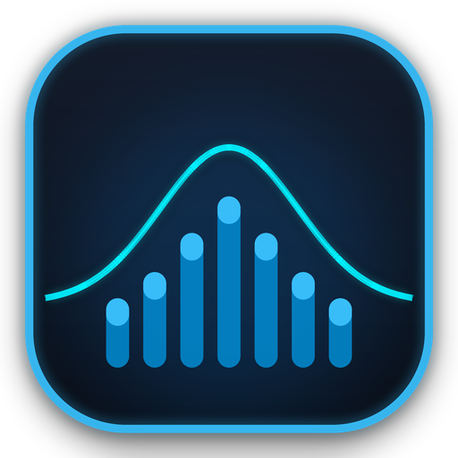

<div align="center">
  
  <h1>Equalizer FD CRAFT</h1>
  <p>
    <strong>Real-Time Microphone DSP Studio &amp; Audio Engine for Windows in Pure Rust</strong><br>
    <em>Студия цифровой обработки звука микрофона в реальном времени с WASAPI-мостом и DeepFilterNet3 LL</em>
  </p>
  <p>
    
    
    
    
  </p>
  <p>
    <a href="#english-documentation">English Documentation</a> • <a href="#документация-на-русском">Документация на русском</a>
  </p>
</div>

---

## English Documentation

### Table of Contents

1. [Architecture and Signal Flow](#architecture-and-signal-flow)
2. [Installation and Quick Start](#installation-and-quick-start)
3. [DSP Modules and Features](#dsp-modules-and-features)
   - [Interactive Parametric EQ and 32-Band RTA Analyzer](#interactive-parametric-eq-and-32-band-rta-analyzer)
   - [Neural AI Noise Suppression (DeepFilterNet3 LL + SpeechGuard)](#neural-ai-noise-suppression-deepfilternet3-ll--speechguard)
   - [Preamp, Effects Rack, and Config Directives](#preamp-effects-rack-and-config-directives)
   - [Roland BOSS RC-505 Mk2 Effects Engine](#roland-boss-rc-505-mk2-effects-engine)
   - [VST 2.4 Plugin Hosting](#vst-24-plugin-hosting)
   - [WASAPI Bridge, Headphone Monitoring, and Stream Stability](#wasapi-bridge-headphone-monitoring-and-stream-stability)
   - [UI, System Tray, and Auto-Updater](#ui-system-tray-and-auto-updater)
4. [Application Setup (Discord, Steam, Telegram, OBS Studio)](#application-setup-discord-steam-telegram-obs-studio)
5. [Keyboard Shortcuts](#keyboard-shortcuts)
6. [Troubleshooting (FAQ)](#troubleshooting-faq)
7. [Building from Source](#building-from-source)

### Architecture and Signal Flow

Equalizer FD CRAFT captures input directly from your physical microphone via WASAPI, runs a deterministic multi-stage DSP chain, and routes the processed signal into `VB-Audio Virtual Cable`.

Signal processing order inside [`ResonaDspEngine`](crates/resona_apo/src/dsp.rs):

```text
[Physical Microphone (WASAPI Capture, 48 kHz)]
        │
        ▼
[Equalizer FD CRAFT / ResonaDSP]
  ├─ 1. 80 Hz Low-Cut High-Pass (runs before neural denoising)
  ├─ 2. DeepFilterNet3 LL (48 kHz, zero-lookahead) + SpeechGuard (fallback: RNNoise)
  ├─ 3. User Preamp (-30..+20 dB, strictly post-AI)
  ├─ 4. Parametric Biquad IIR EQ and Graphic EQ
  ├─ 5. Roland BOSS RC-505 Mk2 Effects (50 algorithms)
  ├─ 6. Smooth Rational Soft Limiter (clip-free peak protection)
  └─ 7. 64-bit VST 2.4 Plugin Chain
        │
        ├───────────────────────────────────────┐
        ▼                                       ▼
[CABLE Input (VB-Audio Virtual Cable)]   [Shared Monitoring Tap (SHARED_TAP_HUB)]
        │                                       │
        ▼                                       ▼
[CABLE Output -> Discord / OBS / Games]  [Headphones / Speakers (zero duplicate AI CPU)]
```

### Installation and Quick Start

1. **Install the Application:** download the latest installer from [GitHub Releases](https://github.com/dimalinau-lab/EqualizerFD-Craft/releases/latest) and run setup. The full installer includes the audio engine, the `DeepFilterNet3_ll_onnx.tar.gz` model archive, and 98 bundled 64-bit VST plugins.
2. **Install VB-Audio Virtual Cable:** open **Settings → Install VB-Audio Virtual Cable...**, launch the driver installer as Administrator, and approve the UAC prompt. Reboot Windows or restart the audio service if required.
3. **Align Sample Rates:** press `Win + R` → run `mmsys.cpl` → **Recording** tab. Ensure both your physical microphone and **`CABLE Output`** are set to **`48000 Hz`** (`24-bit` or `16-bit`).
4. **Select Virtual Input in Apps:** set **`CABLE Output (VB-Audio Virtual Cable)`** as the microphone input device in Discord, OBS Studio, Telegram, and games.

### DSP Modules and Features

#### Interactive Parametric EQ and 32-Band RTA Analyzer

The frequency response canvas renders the combined filter curve overlaid with a real-time 32-band logarithmic Goertzel spectrum analyzer.

- **Node Controls:**
  - **Left-Click on Node:** selects and pins the parameter card in place; click empty canvas space to deselect.
  - **Drag Node:** horizontal movement adjusts frequency (Hz), vertical movement adjusts gain (dB).
  - **Mouse Wheel over Node:** adjusts filter bandwidth (`Q`).
- **Node Card Actions:** `Bypass / On`, `Invert` (flips gain sign), `Delete`.
- **Supported Biquad IIR Filter Types:**
  - `PK` (Peaking) — bell boost/cut at target frequency;
  - `LS` (Low Shelf) — boosts or attenuates frequencies below cutoff;
  - `HS` (High Shelf) — boosts or attenuates high frequencies;
  - `HP` (High Pass) — cuts low rumble, desk thumps, and plosives;
  - `LP` (Low Pass) — attenuates ultrasonic hiss;
  - `NO` (Notch) — narrow band-stop cut for 50/60 Hz hum or tonal ringing.
- **Canvas Controls:** toggle real-time spectrum (`RTA Spectrum`) and `Undock` to detach the graph into a separate window.

#### Neural AI Noise Suppression (DeepFilterNet3 LL + SpeechGuard)

Noise suppression is driven by **DeepFilterNet3 Low-Latency** (`models/DeepFilterNet3_ll_onnx.tar.gz`, `48000 Hz`, `fft_size = 960`, `hop_size = 480`, zero lookahead) with non-blocking preload and cached model parameters. If the model archive is missing, the engine automatically falls back to RNNoise (`nnnoiseless`).

- **Pre-AI High-Pass & Post-AI Preamp:** a fixed `80 Hz` High-Pass removes sub-rumble before inference, while user `Preamp` runs strictly **after** AI denoising so noise floors are never amplified prior to separation.
- **`SpeechGuard`:** adaptive noise-floor tracking (`noise_floor_rms`), anti-click transient rejection comparing speech energy (`180–3600 Hz`) against high-frequency click energy (`> 5 kHz`), dynamic `min_db_thresh`, and word-tail hold (`180 ms` hold, `65 ms` release).
- **Live Telemetry:** reports active backend and SNR (`DFN3-LL | SNR xx dB`) alongside `VAD: Idle / Speech (xx%)`.
- **Wet/Dry Blend (`0%–100%`) & Presets:**
  - `65% (Studio)` — gentle cleanup for quiet rooms while preserving vocal overtones;
  - `85% (Discord / Krisp)` — balanced preset for voice chat and streaming;
  - `100% (Maximum)` — aggressive isolation for loud fans, street noise, and mechanical keyboards.

#### Preamp, Effects Rack, and Config Directives

The effects rack executes blocks sequentially from top to bottom with per-block reorder and bypass toggles.

- **Preamp:** clean digital gain from `-30` to `+20 dB` applied after AI denoising.
- **Graphic Equalizers:** 15-band ISO and 31-band equalizer support.
- **Config Directives (`config.txt`):** supports recursive `Include:` expansion, `Device:`, `Channel:`, and `Copy:` channel routing matrices.

#### Roland BOSS RC-505 Mk2 Effects Engine

Integrated DSP engine implementing 50 studio and vocal effect algorithms, including:
- **Pitch & Vocal:** Pitch Shift, Auto-Pitch, Robot Voice, Vocoder, Voice Double, Octave, Harmonist;
- **Dynamics & Filters:** Dynamic Compressor, Sustainer, Auto-Wah, Radio Voice, Telephone, Lo-Fi, Ring Modulator;
- **Modulation, Space & Rhythm:** Stereo Chorus, Flanger, Phaser, Tremolo, Pan, Tape Echo, Stereo Delay, Hall Reverb, Plate Reverb, Beat Repeat, Scatter, Slicer, Vinyl Flick.

Each effect block exposes parameter controls and curated factory presets.

#### VST 2.4 Plugin Hosting

Supports native 64-bit VST 2.4 DLLs, including 98 pre-bundled studio plugins in `vst_plugins\` (Cockos ReaPlugs, Blue Cat, Kuassa, TDR, and more) as well as third-party DLLs. Supports vendor GUI windows, factory presets, parameter control, and bypass. On startup, the host automatically grants read/execute ACL permissions on `vst_plugins` and `models`.

#### WASAPI Bridge, Headphone Monitoring, and Stream Stability

- **Direct WASAPI Audio Bridge:** operates with a `25 ms` capture buffer (`250_000` HNS) and `20 ms` / `10 ms` init buffering without requiring audio service restarts when parameters change.
- **Pause-Only Drift Compensation:** clock-rate drift adjustment between the USB microphone and virtual cable executes strictly during natural speech pauses so active speech samples are never dropped.
- **Hibernation Watchdog:** detects Windows sleep/hibernation resume events and automatically recovers WASAPI capture/render streams.
- **Headphone Monitoring (Sidetone):** toggle (`[ON AIR]` / `[OFF]`), render device selector, and volume slider in the top toolbar.
  - Subscribes to the already-cleaned 48 kHz output from the VB-Cable bridge via [`SHARED_TAP_HUB`](crates/eq_apo_device/src/stream.rs) with zero duplicate AI CPU overhead.
  - Selected output device, active toggle state, and volume persist in `settings.json` and restore automatically on restart.

#### UI, System Tray, and Auto-Updater

- **Themes:** Light (native Windows desktop look) and Dark themes.
- **Localization:** instant switching between English and Russian.
- **System Tray (`EqualizerTray.exe`):** minimize-to-tray lifecycle, bridge status toggle, Windows autostart configuration, and `audiodg.exe` restart helper.
- **Auto-Updater:** checks GitHub Releases via `/api/update/check` using `CARGO_PKG_VERSION`, offering both lightweight updates (without re-downloading VST plugins) and the full setup installer.

### Application Setup (Discord, Steam, Telegram, OBS Studio)

1. **Discord:** *User Settings → Voice & Video → Input Device* → **`CABLE Output (VB-Audio Virtual Cable)`**. Disable Krisp noise suppression and Automatic Gain Control in Discord to prevent double processing.
2. **Steam / CS2 / Games:** *Settings → Audio → Microphone Device* → **`CABLE Output (VB-Audio Virtual Cable)`**.
3. **Telegram Desktop:** *Settings → Advanced → Call Settings → Microphone* → **`CABLE Output`**.
4. **OBS Studio:** *Settings → Audio → Mic/Auxiliary Audio* → **`CABLE Output`**.

### Keyboard Shortcuts

| Shortcut | Action |
| :--- | :--- |
| `Ctrl + N` | Create a new configuration / tab |
| `Ctrl + O` | Open a `.txt` configuration file |
| `Ctrl + S` | Save the active configuration |
| `Ctrl + Z` | Undo last edit |
| `Ctrl + Y` / `Ctrl + Shift + Z` | Redo undone edit |
| `F8` | Toggle the frequency response / RTA analysis panel |

### Troubleshooting (FAQ)

- **No audio in Discord or games:** verify **`CABLE Output (VB-Audio Virtual Cable)`** is selected as the input device, the WASAPI bridge is live, and `Preamp` is not attenuated.
- **Crackling, robotic artifacts, or stuttering:** open `mmsys.cpl` and confirm both your physical microphone and `CABLE Output` are set to **`48000 Hz`**.
- **Audio looping or repeating:** check the effects rack for active BOSS RC-505 rhythmic units (`Beat Repeat`, `Scatter`, `Slicer`, `Twist Delay`) or third-party VST delays with high feedback, and bypass or remove them.
- **Silent mic after reconnecting USB hardware:** click the bridge restart control in the app or system tray menu.

### Building from Source

Prerequisites: Rust (`cargo`), Windows SDK / MSVC toolchain, and optionally Inno Setup 6 (`D:\Inno Setup 6\ISCC.exe`) for installer packaging.

```powershell
# 1. Clone repository
git clone https://github.com/dimalinau-lab/EqualizerFD-Craft.git
cd EqualizerFD-Craft

# 2. Run test suites
cargo test --release --manifest-path crates/eq_apo_core/Cargo.toml
cargo test --release --manifest-path crates/eq_apo_cli/Cargo.toml
cargo test --release --manifest-path crates/resona_apo/Cargo.toml

# 3. Build release binaries
cargo build --release --manifest-path crates/resona_apo/Cargo.toml
cargo build --release --manifest-path crates/eq_apo_cli/Cargo.toml

# 4. Build Inno Setup installers and ZIP archives into dist/
pwsh -File tools/build_release.ps1
```

---

## Документация на русском

### Содержание

1. [Назначение и схема обработки сигнала](#назначение-и-схема-обработки-сигнала)
2. [Установка и быстрый старт](#установка-и-быстрый-старт)
3. [Модули обработки и функции](#модули-обработки-и-функции)
   - [Интерактивный эквалайзер и 32-полосный анализатор RTA](#интерактивный-эквалайзер-и-32-полосный-анализатор-rta)
   - [Нейросетевое AI-шумоподавление (DeepFilterNet3 LL + SpeechGuard)](#нейросетевое-ai-шумоподавление-deepfilternet3-ll--speechguard)
   - [Предусиление (Preamp), рэк эффектов и директивы](#предусиление-preamp-рэк-эффектов-и-директивы)
   - [Процессор эффектов Roland BOSS RC-505 Mk2](#процессор-эффектов-roland-boss-rc-505-mk2)
   - [Поддержка VST 2.4 плагинов](#поддержка-vst-24-плагинов)
   - [WASAPI-мост, мониторинг в наушниках и стабильность потока](#wasapi-мост-мониторинг-в-наушниках-и-стабильность-потока)
   - [Интерфейс, трей и автообновление](#интерфейс-трей-и-автообновление)
4. [Настройка в Discord, Steam, Telegram и OBS Studio](#настройка-в-discord-steam-telegram-и-obs-studio)
5. [Горячие клавиши](#горячие-клавиши)
6. [Диагностика и устранение неполадок (FAQ)](#диагностика-и-устранение-неполадок-faq)
7. [Сборка из исходников](#сборка-из-исходников)

### Назначение и схема обработки сигнала

Equalizer FD CRAFT перехватывает входной сигнал физического микрофона через прямой WASAPI-мост, применяет последовательную цепочку DSP и направляет обработанный звук в виртуальный аудиодрайвер `VB-Audio Virtual Cable`.

Последовательность обработки в [`ResonaDspEngine`](crates/resona_apo/src/dsp.rs):

```text
[Физический микрофон (WASAPI Capture, 48 kHz)]
        │
        ▼
[Equalizer FD CRAFT / ResonaDSP]
  ├─ 1. 80 Hz Low-Cut (High-Pass фильтр до нейросети)
  ├─ 2. DeepFilterNet3 LL (48 kHz, zero-lookahead) + SpeechGuard (fallback: RNNoise)
  ├─ 3. Preamp (-30..+20 dB, строго после AI-очистки)
  ├─ 4. Параметрический Biquad IIR эквалайзер и графический EQ
  ├─ 5. Эффекты Roland BOSS RC-505 Mk2 (50 алгоритмов)
  ├─ 6. Smooth Rational Soft Limiter (плавное ограничение пиков без клиппинга)
  └─ 7. Цепочка 64-битных VST 2.4 плагинов
        │
        ├───────────────────────────────────────┐
        ▼                                       ▼
[CABLE Input (VB-Audio Virtual Cable)]   [Общий Tap-поток мониторинга (SHARED_TAP_HUB)]
        │                                       │
        ▼                                       ▼
[CABLE Output -> Discord / OBS / Игры]   [Наушники / Динамики (без дублирования AI CPU)]
```

### Установка и быстрый старт

1. **Установка приложения:** скачайте актуальный установщик из раздела [GitHub Releases](https://github.com/dimalinau-lab/EqualizerFD-Craft/releases/latest) и запустите установку. Полный инсталлятор включает движок, архив модели `DeepFilterNet3_ll_onnx.tar.gz` и набор из 98 64-битных VST-плагинов.
2. **Установка VB-Audio Virtual Cable:** в приложении откройте меню **«Настройки» → «Установить VB-Audio Virtual Cable...»**, нажмите кнопку установки от имени Администратора и подтвердите UAC. При необходимости перезагрузите ПК или перезапустите аудиослужбу.
3. **Настройка частоты дискретизации:** откройте `Win + R` → `mmsys.cpl` → вкладка **«Запись»**. В свойствах физического микрофона и устройства **`CABLE Output`** установите одинаковый формат **`48000 Гц`** (`24 бит` или `16 бит`).
4. **Выбор устройства ввода в программах:** укажите **`CABLE Output (VB-Audio Virtual Cable)`** в качестве микрофона в Discord, OBS Studio, Telegram и играх.

### Модули обработки и функции

#### Интерактивный эквалайзер и 32-полосный анализатор RTA

График АЧХ отображает суммарную кривую всех активных фильтров и живой логарифмический анализатор спектра (32 полосы, расчёт по алгоритму Goertzel).

- **Работа с узлами на графике:**
  - **Клик левой кнопкой по узлу:** выбор узла и фиксация карточки точной настройки параметров. Клик по пустой области снимает выделение.
  - **Перетаскивание мышью:** по горизонтали — частота (Гц), по вертикали — усиление/ослабление (дБ).
  - **Колесо мыши над узлом:** изменение добротности (`Q`, ширина полосы фильтра).
- **Действия в карточке узла:** `Bypass / Вкл`, `Инверт` (инверсия усиления в дБ), `Удалить`.
- **Поддерживаемые типы фильтров Biquad IIR:**
  - `PK` (Peaking) — точечный подъём или вырез полосы;
  - `LS` (Low Shelf) — подъём/срез всех частот ниже порога;
  - `HS` (High Shelf) — подъём/срез верхних частот;
  - `HP` (High Pass) — срез низких частот и инфразвука (удары по столу, дыхание);
  - `LP` (Low Pass) — срез высокочастотного свиста;
  - `NO` (Notch) — узкополосный режекторный вырез сетевого фона (50/60 Гц) и постоянных резонансов.
- **Элементы управления графиком:** включение/отключение спектрального анализатора (`RTA Спектр`) и кнопка `Открепить` для выноса графика в отдельное окно.

#### Нейросетевое AI-шумоподавление (DeepFilterNet3 LL + SpeechGuard)

Шумоподавление построено на нейросетевой модели **DeepFilterNet3 Low-Latency** (`models/DeepFilterNet3_ll_onnx.tar.gz`, `48000 Hz`, `fft_size = 960`, `hop_size = 480`, без lookahead) с неблокирующей предзагрузкой и кэшированием весов. При отсутствии архива модели автоматически активируется резервный движок RNNoise (`nnnoiseless`).

- **Stage 0 перед AI:** неотключаемый фильтр `80 Hz High-Pass` убирает инфразвуковой гул до входа в нейросеть; пользовательский `Preamp` выполняется строго **после** AI, чтобы фоновый шум не усиливался до разделения сигнала.
- **`SpeechGuard`:** адаптивная оценка уровня шума (`noise_floor_rms`), защита от пропуска коротких импульсных щелчков (механическая клавиатура, клики мыши) за счёт анализа полосы речи (`180–3600 Гц`) относительно ВЧ (`> 5 кГц`), динамический порог `min_db_thresh` и удержание окончаний слов (`180 ms` hold, `65 ms` release).
- **Телеметрия в реальном времени:** отображение активного движка (`DFN3-LL | SNR xx dB` / RNNoise fallback) и индикатор состояния речи `VAD: Ожидание речи / Голос (xx%)`.
- **Управление силой смешивания (`0%–100%`):** плавный регулятор и три быстрых пресета:
  - `65% (Студийный)` — мягкая очистка в тихом помещении с сохранением естественного тембра;
  - `85% (Discord / Krisp)` — базовый баланс для голосовой связи и стриминга;
  - `100% (Максимум)` — максимальная изоляция речи в шумной обстановке.

#### Предусиление (Preamp), рэк эффектов и директивы

Рэк обрабатывает блоки сверху вниз (порядок и включение изменяются кнопками на карточке каждого блока).

- **Preamp:** цифровое усиление от `-30` до `+20 dB` после AI-шумоподавления.
- **Графические эквалайзеры:** 15-полосный ISO и 31-полосный режим.
- **Директивы совместимости конфигов (`config.txt`):** поддержка `Include:` (рекурсивное разворачивание при загрузке), `Device:`, `Channel:` и `Copy:` (матрица маршрутизации каналов).

#### Процессор эффектов Roland BOSS RC-505 Mk2

Встроенный DSP-модуль содержит 50 алгоритмов обработки голоса и эффектов, включая:
- **Высота и форманта:** Pitch Shift, Auto-Pitch, Robot Voice, Vocoder, Voice Double, Octave, Harmonist;
- **Динамика и фильтрация:** Dynamic Compressor, Sustainer, Auto-Wah, Radio Voice, Telephone, Lo-Fi, Ring Modulator;
- **Пространство и модуляция:** Stereo Chorus, Flanger, Phaser, Tremolo, Pan, Tape Echo, Stereo Delay, Hall Reverb, Plate Reverb и ритмические эффекты (Beat Repeat, Scatter, Slicer, Vinyl Flick).

Для каждого эффекта доступны индивидуальные параметры и встроенные пресеты.

#### Поддержка VST 2.4 плагинов

Движок поддерживает 64-битные VST 2.4 плагины (98 предустановленных DLL в каталоге `vst_plugins\` — Cockos ReaPlugs, Blue Cat, Kuassa, TDR и др., а также любые сторонние VST 2.4 DLL). Доступны открытие штатного GUI плагина, переключение заводских пресетов, управление параметрами и Bypass. При запуске автоматически настраиваются ACL-права чтения для каталогов `vst_plugins` и `models`.

#### WASAPI-мост, мониторинг в наушниках и стабильность потока

- **Прямой WASAPI аудиомост (`[В ЭФИРЕ]` / `[ОСТАНОВЛЕН]`):** считывает микрофон напрямую с буфером захвата `25 ms` (`250_000` HNS) и инициализационной буферизацией `20 ms` / `10 ms`, без необходимости перезагружать аудиослужбу при изменении настроек.
- **Pause-Only Drift Compensation:** компенсация рассинхронизации тактовых генераторов USB-микрофона и виртуального кабеля выполняется только в естественных паузах речи, не затрагивая активный голосовой сигнал.
- **Hibernation Watchdog:** отслеживание выхода Windows из спящего режима/гибернации с автоматическим перезапуском аудиосессии.
- **Мониторинг в наушники (Sidetone):** кнопка `[В ЭФИРЕ]` / `[ВЫКЛ]`, выбор устройства вывода (наушники/динамики) и регулятор громкости на верхней панели.
  - Поток прослушки подключается к уже обработанному выходу VB-Cable моста через [`SHARED_TAP_HUB`](crates/eq_apo_device/src/stream.rs) — повторный расчёт AI и DSP на CPU не выполняется.
  - Выбранное устройство вывода, активность мониторинга и уровень громкости автоматически сохраняются в `settings.json` и восстанавливаются при следующем запуске программы.

#### Интерфейс, трей и автообновление

- **Темы оформления:** Светлая (классическая Windows) и Тёмная.
- **Локализация:** переключение между русским и английским языками (`Язык`).
- **Системный трей (`EqualizerTray.exe`):** сворачивание в трей при закрытии, управление мостом, автозапуском Windows (`Автозагрузка при старте Windows`) и перезапуском аудиослужбы `audiodg.exe`.
- **Автообновление:** встроенная проверка новых релизов в GitHub Releases через `/api/update/check` (версия приложения привязана к `CARGO_PKG_VERSION`), с поддержкой быстрого обновления без повторной загрузки VST-пакета и полного установщика.

### Настройка в Discord, Steam, Telegram и OBS Studio

1. **Discord:** *Настройки пользователя → Голос и видео → Устройство ввода* → **`CABLE Output (VB-Audio Virtual Cable)`**. Отключите встроенное шумоподавление Krisp и автоматическую регулировку усиления (AGC), чтобы избежать двойной обработки сигнала.
2. **Steam / CS2 / Игры:** *Настройки → Звук → Устройство записи* → **`CABLE Output (VB-Audio Virtual Cable)`**.
3. **Telegram Desktop:** *Настройки → Продвинутые настройки → Звонки → Микрофон* → **`CABLE Output`**.
4. **OBS Studio:** *Настройки → Аудио → Микрофон/Доп. аудио* → **`CABLE Output`**.

### Горячие клавиши

| Комбинация | Действие |
| :--- | :--- |
| `Ctrl + N` | Создать новую конфигурацию / вкладку |
| `Ctrl + O` | Открыть файл конфигурации `.txt` |
| `Ctrl + S` | Сохранить текущую конфигурацию |
| `Ctrl + Z` | Отменить последнее действие |
| `Ctrl + Y` / `Ctrl + Shift + Z` | Повторить отменённое действие |
| `F8` | Показать или скрыть панель анализа АЧХ |

### Диагностика и устранение неполадок (FAQ)

- **Нет звука в Discord или игре:** убедитесь, что устройством ввода выбрано **`CABLE Output (VB-Audio Virtual Cable)`**, индикатор WASAPI-моста находится в состоянии `[В ЭФИРЕ]`, а ползунок `Preamp` не заглушён.
- **Треск, искажения или «металлический» призвук:** проверьте `mmsys.cpl` — частота дискретизации физического микрофона и `CABLE Output` должна строго совпадать (**`48000 Гц`**).
- **Повторяющиеся звуки или зацикливание:** проверьте правый рэк на наличие активных ритмических блоков BOSS RC-505 (`Beat Repeat`, `Scatter`, `Slicer`, `Twist Delay`) либо сторонних VST-дилеев с высокой обратной связью; при необходимости отключите блок.
- **Пропал звук после переподключения USB-микрофона:** нажмите кнопку переподключения/перезапуска аудиомоста в интерфейсе или в контекстном меню трея.

### Сборка из исходников

Требования: установленный Rust (`cargo`), Windows SDK / MSVC toolchain и опционально Inno Setup 6 (`D:\Inno Setup 6\ISCC.exe`) для сборки установщиков.

```powershell
# 1. Клонирование репозитория
git clone https://github.com/dimalinau-lab/EqualizerFD-Craft.git
cd EqualizerFD-Craft

# 2. Проверка тестов
cargo test --release --manifest-path crates/eq_apo_core/Cargo.toml
cargo test --release --manifest-path crates/eq_apo_cli/Cargo.toml
cargo test --release --manifest-path crates/resona_apo/Cargo.toml

# 3. Сборка релизных бинарников
cargo build --release --manifest-path crates/resona_apo/Cargo.toml
cargo build --release --manifest-path crates/eq_apo_cli/Cargo.toml

# 4. Упаковка установщиков Inno Setup и ZIP-архивов в dist/
pwsh -File tools/build_release.ps1
```

---

License / Лицензия: [MIT](LICENSE)
